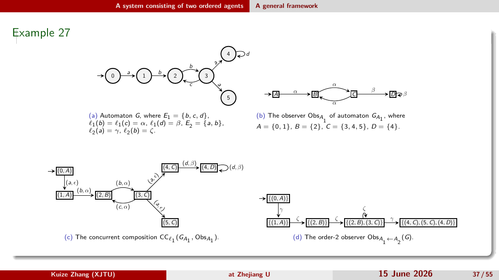

# 二阶观测器构造工具

## 项目简介

本项目根据一个有限状态自动机（FSA）和两个智能体的观测配置，自动构造离散事件系统中的二阶观测器。

## 输入与输出

- 输入：FSA 模型、Agent 1 配置和 Agent 2 配置，均为 JSON 文件。
- 输出：JSON 格式的二阶观测器，以及可选的中间结果。

### 输入格式

FSA 文件示例：

```json
{
  "states": ["0", "1"],
  "events": ["a"],
  "transitions": [
    {"source": "0", "event": "a", "target": "1"}
  ],
  "initial_states": ["0"]
}
```

- `states`：状态集合。
- `events`：事件集合。
- `transitions`：转移关系；状态和事件必须已在对应集合中声明。
- `initial_states`：非空初始状态集合。

Agent 文件示例：

```json
{
  "agent": "A1",
  "events": ["a"],
  "alphabet": ["alpha"],
  "label_function": {"a": "alpha"}
}
```

- `agent`：可选的智能体名称。
- `events`：该智能体可观测的 FSA 事件。
- `alphabet`：输出标签集合。
- `label_function`：为 `events` 中每个事件指定标签；标签必须属于 `alphabet`。

未列入 Agent `events` 的 FSA 事件会被视为不可观测事件。完整示例位于 `data/models/` 和 `data/agents/`。

## 快速开始

要求 Python 3.10 或更高版本。项目仅使用 Python 标准库。

```bash
python src/order2_observer.py \
  data/models/Example27_G.json \
  data/agents/Example27_A1.json \
  data/agents/Example27_A2.json \
  output.json
```

Windows 用户也可将 `python` 替换为 `py -3`。运行成功后，结果保存在 `output.json`。

保存各阶段中间结果：

```bash
python src/order2_observer.py \
  data/models/Example27_G.json \
  data/agents/Example27_A1.json \
  data/agents/Example27_A2.json \
  output.json \
  --intermediates-dir intermediate-results
```

## 使用 Docker

先安装并启动 Docker Desktop，然后在项目根目录构建镜像：

```powershell
docker build -t observer .
```

运行仓库中的 Example27：

```powershell
docker run --rm -v "${PWD}:/data" observer `
  /data/data/models/Example27_G.json `
  /data/data/agents/Example27_A1.json `
  /data/data/agents/Example27_A2.json `
  /data/output.json
```

`-v` 将当前项目目录挂载到容器的 `/data`。运行完成后，结果保存在项目根目录的 `output.json`。

使用自己的数据时，替换命令中的三个输入文件路径和输出文件名即可。修改 Dockerfile 或源代码后，需要重新执行构建命令。

## 运行测试

安装 pytest 后运行：

```bash
python -m pytest
```

该测试会重新计算 Example27，并与仓库中的预期结果自动比较。

## 理论背景

### 有限状态自动机

有限状态自动机定义为

$$G=(Q,E,\delta,Q_0),$$

其中 $Q$ 为有限状态集，$E$ 为有限事件集，$\delta\subseteq Q\times E\times Q$ 为转移关系，$Q_0\subseteq Q$ 为初始状态集。

带标记有限状态自动机（LFSA）定义为

$$S=(Q,E,\delta,Q_0,\Sigma,\ell),$$

其中 $\Sigma$ 为有限输出字母表，$\ell:E\to\Sigma\cup\{\epsilon\}$ 为标记函数。可观事件集与不可观事件集分别为

$$E_o=\{e\in E\mid \ell(e)\in\Sigma\},\qquad E_{uo}=\{e\in E\mid \ell(e)=\epsilon\}.$$

对 $\alpha\in\Sigma^*$，当前状态估计定义为

$$M(S,\alpha)=\{q\in Q\mid \exists q_0\in Q_0,\exists s\in E^*:q_0\xrightarrow{s}q\land\ell(s)=\alpha\}.$$

### 并发组合

给定 $S_i=(Q_i,E_i,\delta_i,Q_{0i},\Sigma,\ell_i)$（$i=1,2$），其并发组合定义为

$$CC(S_1,S_2)=(Q',E',\delta',Q'_0,\Sigma,\ell'),$$

其中

$$Q'=Q_1\times Q_2,\qquad Q'_0=Q_{01}\times Q_{02},$$

$$E'=E'_o\cup E'_{uo},$$

$$E'_o=\{(e_1,e_2)\mid e_i\in E_{io},\ \ell_1(e_1)=\ell_2(e_2)\},$$

$$E'_{uo}=\{(e_1,\epsilon)\mid e_1\in E_{1uo}\}\cup\{(\epsilon,e_2)\mid e_2\in E_{2uo}\}.$$

转移关系 $\delta'$ 定义为

$$((q_1,q_3),(e_1,e_2),(q_2,q_4))\in\delta'\iff(q_1,e_1,q_2)\in\delta_1\land(q_3,e_2,q_4)\in\delta_2,$$

$$((q_1,q_3),(e_1,\epsilon),(q_2,q_3))\in\delta'\iff(q_1,e_1,q_2)\in\delta_1,$$

$$((q_1,q_3),(\epsilon,e_2),(q_1,q_4))\in\delta'\iff(q_3,e_2,q_4)\in\delta_2,$$

且 $\ell'((e_1,e_2))=\ell_1(e_1)=\ell_2(e_2)$。

### 观测器

LFSA $S$ 的观测器定义为确定性有限状态自动机

$$Obs(S)=(Q_{obs},\ell(E_o),\delta_{obs},q_{0,obs}),$$

其中

$$Q_{obs}=2^Q,$$

$$q_{0,obs}=\bigcup_{q_0\in Q_0}\ \bigcup_{s\in E_{uo}^*}\delta(q_0,s)=M(S,\epsilon),$$

$$\delta_{obs}(X,a)=\bigcup_{q\in X}\ \bigcup_{\substack{e\in E_o\\\ell(e)=a}}\ \bigcup_{s\in E_{uo}^*}\delta(q,es).$$

### 二阶观测器

对智能体 $A_i$ 的标记函数 $\ell_i:E\to\Sigma_i\cup\{\epsilon\}$，$A_2$ 在观测到 $\alpha\in\ell_2(L(G))$ 后对 $A_1$ 状态估计的二阶估计定义为

$$M_{A_1\leftarrow A_2}(G,\alpha)=\{M(G,\ell_1(s))\mid s\in\ell_2^{-1}(\alpha)\cap L(G)\}\subseteq 2^Q.$$

二阶谓词定义为

$$PRED_2\subseteq 2^{2^Q}.$$

二阶观测器定义为

$$Obs_{A_1\leftarrow A_2}(G)=Obs_{\ell_2}\!\left(CC^{G,Obs_{A_1}}_{A_1\to A_2}\right),$$

其中 $Obs_{A_1}=Obs_{\ell_1}(G)$，$CC^{G,Obs_{A_1}}_{A_1\to A_2}$ 由 $CC_{\ell_1}(G_{A_1},Obs_{A_1})$ 将事件对 $(e_1,e_2)$ 投影为 $e_1$，并以 $\ell_2$ 重标记得到。

## 项目架构

```text
.
├── src/                 # 核心算法与转换工具
│   ├── order2_observer.py   # 二阶观测器构造入口
│   ├── observer.py          # 一阶观测器构造
│   ├── CC.py                # LFSA 并发合成算子
│   ├── fa_agent_to_lfsa.py  # FSA 与 agent 合并得到 LFSA
│   ├── fa_to_lfsa.py        # FSA 转 LFSA
│   ├── lfsa_to_fa.py        # LFSA 转 FSA
│   └── relabel_composition.py # 组合结果投影与重标记
├── data/
│   ├── models/          # DES 模型输入
│   ├── agents/          # agent 配置输入
│   └── results/         # 算法输出与中间结果
└── docs/                # 理论文献与说明
```

## 例子


